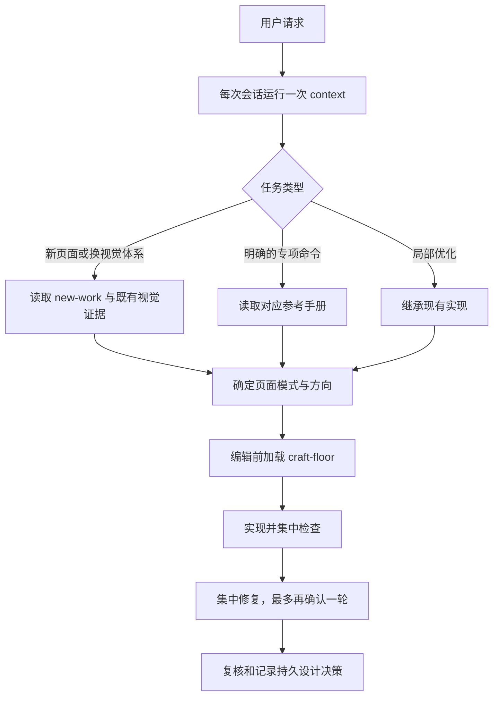

# impeccable · 详细设计讲解

> **来源**：`skills/impeccable/impeccable/SKILL.md`  
> **定位**：分析设计选择、代价与失效条件；逐段内容见[中文版](impeccable-中文版.md)。

## 它解决什么问题

通用前端提示词容易把不同产品压进同几种熟悉模板：相似字体、渐变、卡片、首屏结构，以及只展示正常状态的静态页面。即使提示词写了“做得精致”，模型仍可能没有产品事实、页面目的和既有视觉体系的记忆，也没有明确的验收与退出条件。Impeccable 试图把这些判断拆成可复用的工作流：产品事实由 `PRODUCT.md` 承载，视觉体系由 `DESIGN.md` 承载，单个页面有自己的方向，命令手册处理具体任务，检测器和复核处理落地质量。

它隐含的前提是：好的界面需要从用户场景和产品机制推导，而不是从行业模板挑选；设计决策需要被记录和验证；在若干关键节点上，用户拥有最终取舍权。其主张是高投入的视觉工艺，因此执行成本明显高于一次性生成页面。

## 核心设计决策

### 决策一：单技能入口，按命令加载手册

**选了什么**：只暴露一个 `impeccable` 技能入口，再用 `shape`、`critique`、`audit`、`polish` 等命令分流到参考文件。

**为什么**：所有任务共享产品上下文与设计原则，但不同任务需要的步骤差异很大。一个入口能保持统一语言，按需加载则避免把全部手册灌入每次会话。

**备选与放弃**：也可为 24 个命令分别做独立技能，触发会更精确，却会重复维护共同规则，并让“当前是重设计还是局部优化”难以跨命令保持一致。代价是单入口描述范围很宽，隐含命令的路由仍依赖模型判断，可能选错手册。

### 决策二：把产品事实、视觉体系、页面方向分层保存

**选了什么**：`PRODUCT.md` 记录稳定的产品事实，`DESIGN.md` 记录跨页面视觉决策，页面简报记录单个界面的策略与方向。

**为什么**：产品目标通常比视觉方案更稳定，视觉方案又比某个页面构图更稳定。分层使重设计可以替换视觉体系而保留产品真相，也避免局部页面把自己的决定扩散到全站。

**备选与放弃**：只用一份 `DESIGN.md` 简单，但混合了事实、品牌和页面细节；全放在会话里则会随会话结束丢失。代价是多个文件会漂移，`doctor` 因而成为必要工具；当文档已过期时，错误上下文甚至比没有文档更危险。

### 决策三：先定方向，后落代码；现有视觉必须取证

**选了什么**：新页面或替换视觉体系进入 `new-work`；先看既有实现、简报与用户场景，再确定方向。缺少 `DESIGN.md` 不等于没有视觉权威。对新视觉体系，手册还用候选方向和随机抽取机制打断模型的惯性选择。

**为什么**：如果先写页面，后续讨论很容易围绕已经写出的模板微调，形成沉没成本。明确方向让最终渲染能与已选构图比对。

**备选与放弃**：可以直接生成一个页面再让用户选喜欢与否，速度快，但选择集由模型默认审美决定；也可以只用文字列出方向，成本较低，却难以检验构图。此设计的代价是前期讨论、视觉方案和批准环节较多；对明确的小修，完整流程会过重，所以源码要求局部扩展直接继承现有体系。

### 决策四：按访问者任务选择模式，而非按产品类别

**选了什么**：以“说服、操作、阅读、体验”四种成功方式判断当前页面，而不是把整款产品统一贴成“营销”或“工具”。

**为什么**：同一个产品的落地页要促成行动，后台要帮助完成任务，文档要帮助理解。模式让视觉表现服从页面用途。

**备选与放弃**：按网站类型或行业分类更省事，却会让工具落地页像控制台、品牌文档像广告。代价是混合页面需要人为判断主任务，分类错误会带错设计重点。

### 决策五：自动检测与人工判断并行，验证有退出上限

**选了什么**：启动器读取上下文；检测器和钩子发现可机械识别的质量问题；`critique`、交付复核和实际截图处理层级、情绪、真实内容等判断。整轮验证最多一次集中修复加一次确认。

**为什么**：检测器可以稳定抓住重复问题，却不能决定一套视觉世界是否适合这个受众；无限人工复查又会拖慢交付且可能越改越偏。

**备选与放弃**：只靠自动规则更快，但规则无法判断语义和美感；只靠人工评审更灵活，但常漏掉对比度、状态和响应式细节。代价是检测器会误报或诱导为规则优化，有限轮次也可能留下未发现的问题，需要按风险决定何时另开专项审计。

## 机制如何运转

最容易违反的约束是**在没有判断既有视觉权威和页面范围前，直接把局部任务当作全新设计**。这会让单个功能无意间替换品牌身份。另一个常见偏差是检测出 `CONTEXT_STALE` 后顺手修复项目产物；源码要求把漂移修复当作独立任务，除自动项外仅报告。

## 什么时候会失效

| 场景 | 后果 | 原因 |
|---|---|---|
| `PRODUCT.md` 或 `DESIGN.md` 已过期，却被当作事实 | 方向和实现与当前产品冲突 | 持久文档有权威感，但没有自动保证时效 |
| 用户只要极小修改，却套用完整新作品流程 | 时间和沟通成本超过收益 | 多方案、方向确认和视觉迭代是为开放设计题准备的 |
| 页面模式判断错误，如把操作页当营销页 | 视觉强度盖过可用性或转化目标 | 四种模式依赖对访问者任务的正确判断 |
| 启动器下载失败、浏览器或应用无法运行 | 上下文加载和视觉验证受限 | 独立二进制、运行环境和真实渲染是部分流程的依赖 |
| 检测器规则与明确简报冲突 | 优化成规则喜欢、用户不想要的样子 | 机械规则只识别模式，不能解释设计意图 |
| 缺少真实图片、文案或数据 | 视觉稿看似完整，发布时塌陷 | 排版和构图对素材比例、长度和真实性敏感 |
| 手册版本、启动器版本与项目产物不一致 | 命令行为和文档预期发生偏差 | 技能、二进制和持久产物各有更新周期 |
| 交付后只看一次截图，未覆盖关键状态 | 错误、空状态、键盘操作或移动端缺陷漏出 | 静态首屏不能代表完整用户路径 |

## 与其他技能的协作

| 关系 | 说明 |
|---|---|
| 与 `frontend-design` | 两者都提供视觉设计指导；Impeccable 将方向选择、专项命令、检测和交付复核串为更完整的工作流。若两者同时安装，应先确定以哪套设计流程为主，避免重复审美指令。 |
| 与 `frontend-design-premium` | 后者偏重应用行为、一致性、安全和本地化契约；Impeccable 偏重视觉方向与专项打磨。产品后台可借用其行为约束，但共同使用时需对 `DESIGN.md` 的维护方式达成一致。 |
| 与 `brainstorming` | 都在实现前厘清选择。前者是通用需求与设计探索；Impeccable 的 `shape` 和 `new-work` 专门处理界面任务，避免对同一决策重复发问。 |
| 与 `writing-plans`、`test-driven-development` | 设计方向明确后，它们负责实施步骤与功能行为验证；Impeccable 的截图、检测器和评审覆盖视觉与体验证据。 |
| 与 `requesting-code-review` | 代码评审检查实现质量；Impeccable 的收尾复核检查实际渲染是否符合既定方向和交付标准。两类复核的证据不同。 |

## 相关

- [impeccable · 中文版](impeccable-中文版.md)
- [本套件技能原理深度讲解](技能原理深度讲解.md)
