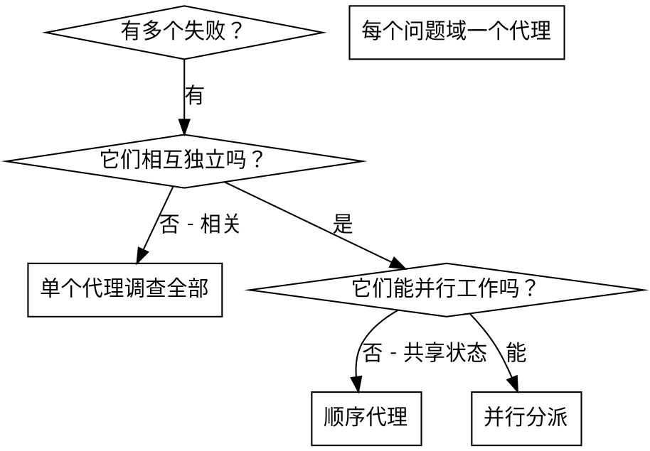

# dispatching-parallel-agents · 中文版

> **来源**：`skills/superpowers/dispatching-parallel-agents/SKILL.md`
> **类型**：协作技能（并行分派，用于调试与多问题域场景）
> **触发**：可自动触发（description：当面对 2 个以上相互独立、无共享状态、无顺序依赖的任务时）

---

## frontmatter

- **name**：`dispatching-parallel-agents`
- **description**：当面对 2 个以上相互独立、可以无需共享状态或顺序依赖地并行处理的任务时使用。

## 概述

你把任务委托给具有**隔离上下文**的专门代理。通过精确地构造它们的指令和上下文，你能确保它们保持专注并成功完成任务。它们**永远不应该继承你所在会话的上下文或历史**——你精确地构造它们所需要的东西。这同时也保护了你自己的上下文，让它留给协调工作。

当你有多个**互不相关**的失败（不同的测试文件、不同的子系统、不同的 bug）时，顺序排查它们是在浪费时间。每一次调查都是独立的，可以并行发生。

**核心原则：** 每个独立的问题域派发一个代理。让它们并发工作。

## 什么时候使用



> **批注**：这棵树有**两级判定**，第二级容易被忽略——"独立"和"能并行"是**两个不同的问题**。两个失败可能逻辑上完全独立（修一个不会修好另一个），但它们仍可能**碰同一份资源**：同一个文件、同一个数据库、同一个端口。逻辑独立 ≠ 不冲突。

**适用场景：**

- 3 个以上测试文件因不同根因失败
- 多个子系统各自独立地坏了
- 每个问题无需其他问题的上下文就能被理解
- 各次调查之间没有共享状态

**不适用场景：**

- 失败之间是相关的（修一个可能顺带修好别的）
- 需要理解整个系统的状态
- 代理之间会相互干扰

## 模式

### 1. 识别独立的问题域

按"什么东西坏了"给失败分组：

- 文件 A 的测试：工具审批流程
- 文件 B 的测试：批次完成行为
- 文件 C 的测试：中止功能

每个域都是独立的——修复工具审批不影响中止相关的测试。

### 2. 构造聚焦的代理任务

每个代理拿到：

- **明确的范围**：一个测试文件或一个子系统
- **清晰的目标**：让这些测试通过
- **约束**：不要改动其它代码
- **预期输出**：你发现了什么、修复了什么的摘要

> **批注**：**"约束"这一项不是可选的礼貌用语，而是必需品**。原文的 Common Mistakes 里把"没有约束"单独列为一条错误，理由是 `Agent might refactor everything`——代理在隔离上下文里工作，它看不到全局，因此**无法自行判断自己的修改是否会波及其他部分**。约束是在替它补上这个它无法获得的信息。

### 3. 并行分派

```typescript
// 在 Claude Code / AI 环境中
Task("修复 agent-tool-abort.test.ts 的失败")
Task("修复 batch-completion-behavior.test.ts 的失败")
Task("修复 tool-approval-race-conditions.test.ts 的失败")
// 三个并发运行
```

### 4. 审查并整合

当代理返回时：

- 阅读每份摘要
- 验证各修复之间**不冲突**
- 运行**完整**测试套件
- 整合所有变更

## 代理 prompt 的结构

好的代理 prompt 是这样：

1. **聚焦**——一个清晰的问题域
2. **自包含**——包含理解该问题所需的全部上下文
3. **对输出有明确要求**——代理应该返回什么？

```markdown
修复 src/agents/agent-tool-abort.test.ts 里 3 个失败的测试：

1. "should abort tool with partial output capture" —— 期望消息里含 'interrupted at'
2. "should handle mixed completed and aborted tools" —— 快速工具被中止而非完成
3. "should properly track pendingToolCount" —— 期望 3 个结果但得到 0

这些是时序 / 竞态条件问题。你的任务：

1. 读测试文件，理解每个测试在验证什么
2. 定位根因——是时序问题，还是真实 bug？
3. 修复方式：
   - 用基于事件的等待替换任意超时
   - 如果发现中止实现里有 bug，修掉它
   - 如果测试的是已变更的行为，调整测试预期

不要只是加大超时时间——找到真正的问题。

返回：你发现了什么、修复了什么的摘要。
```

## 常见错误

**❌ 太宽泛：**"修复所有测试"——代理会迷失
**✅ 具体：**"修复 agent-tool-abort.test.ts"——范围聚焦

**❌ 没有上下文：**"修复竞态条件"——代理不知道在哪
**✅ 有上下文：**把报错信息和测试名粘进去

**❌ 没有约束：**代理可能会重构一切
**✅ 有约束：**"不要改生产代码"或"只修测试"

**❌ 输出要求含糊：**"修好它"——你不知道改了什么
**✅ 具体：**"返回根因和变更的摘要"

## 什么时候**不要**用

**失败之间相关：**修一个可能顺带修好别的——先一起调查
**需要完整上下文：**理解问题需要看到整个系统
**探索性调试：**你还不知道哪里坏了
**共享状态：**代理之间会互相干扰（编辑同一文件、使用同一资源）

## 会话中的真实例子

**场景：** 一次大重构之后，3 个文件里共 6 个测试失败

**失败情况：**

- `agent-tool-abort.test.ts`：3 个失败（时序问题）
- `batch-completion-behavior.test.ts`：2 个失败（工具没有执行）
- `tool-approval-race-conditions.test.ts`：1 个失败（执行计数 = 0）

**判断：** 相互独立的问题域——中止逻辑、批次完成、竞态条件三者互不相关

**分派：**

```
代理 1 → 修复 agent-tool-abort.test.ts
代理 2 → 修复 batch-completion-behavior.test.ts
代理 3 → 修复 tool-approval-race-conditions.test.ts
```

**结果：**

- 代理 1：把超时替换成了基于事件的等待
- 代理 2：修复了事件结构 bug（threadId 放错了位置）
- 代理 3：补上了对异步工具执行完成的等待

**整合：** 所有修复彼此独立、无冲突，完整测试套件转绿

**节省的时间：** 3 个问题并行解决，而非顺序解决

## 核心收益

1. **并行化**——多个调查同时进行
2. **聚焦**——每个代理范围窄，要跟踪的上下文更少
3. **独立**——代理之间互不干扰
4. **速度**——3 个问题用 1 个问题的时间解决

## 验证

代理返回之后：

1. **审查每份摘要**——理解改了什么
2. **检查冲突**——代理是否编辑了同一处代码？
3. **运行完整套件**——验证所有修复能协同工作
4. **抽查**——代理可能犯**系统性错误**

> **批注**："代理可能犯系统性错误"这句是整节里最值得留意的一处。它指的不是"某个代理犯了错"，而是**多个代理可能因为同一个错误前提而犯同一个错**——比如三者都误解了某个 API 的语义。这种错误**不会在冲突检查中暴露**（各改各的文件，互不冲突），也不会在单个摘要中显得异常（每份看起来都合理）。只能靠**抽查**和**跑完整套件**发现。这也解释了为什么第 4 步不是"信任并合入"，而是"验证再合入"。

## 真实影响

来自一次调试会话（2025-10-03）：

- 3 个文件里 6 个失败
- 3 个代理并行分派
- 所有调查并发完成
- 所有修复成功整合
- 代理变更之间零冲突

---

## 附属文件

无。本技能是一个单独的 `SKILL.md`。

---

## 相关

- [dispatching-parallel-agents-详细设计讲解.md](./dispatching-parallel-agents-详细设计讲解.md) —— 本文的设计分析：并行前置条件的危险性、与 subagent-driven-development 的边界
- [subagent-driven-development-中文版.md](./subagent-driven-development-中文版.md) —— 那个技能**禁止**并行实现，边界见详细设计讲解
- [systematic-debugging-中文版.md](./systematic-debugging-中文版.md) —— 单个问题域的根因分析流程
- [技能原理深度讲解.md](./技能原理深度讲解.md) —— Superpowers 整体原理
