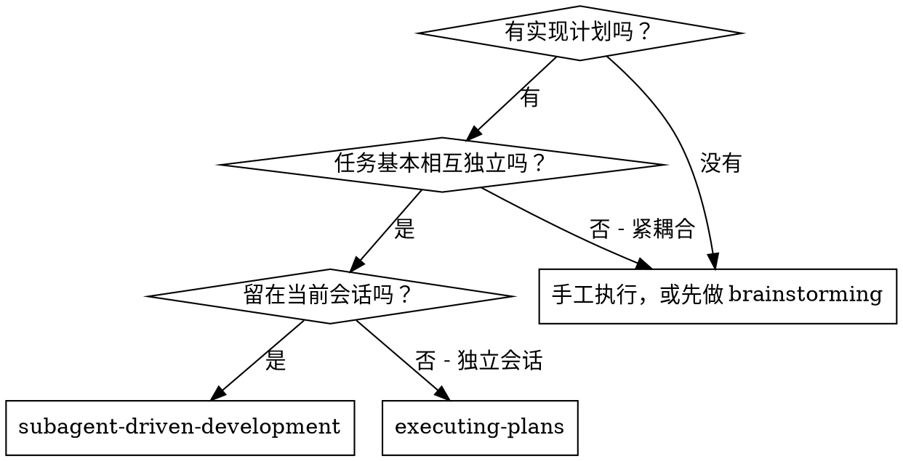
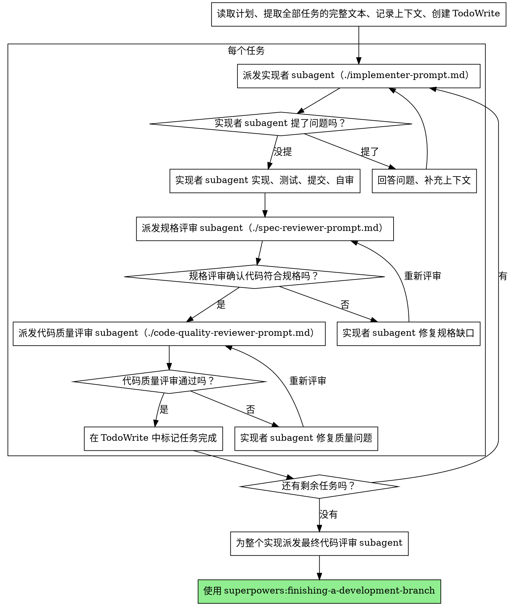

# subagent-driven-development · 中文版

> **来源**：`skills/superpowers/subagent-driven-development/SKILL.md`
> **类型**：执行技能（当前会话 / 有 subagent 支持时的首选执行模式）
> **触发**：可自动触发（description：当你有一个由相互独立的任务构成的实现计划，且要在**当前会话**中执行时）

---

## frontmatter

- **name**：`subagent-driven-development`
- **description**：当你有一个由相互独立的任务构成的实现计划，且要在**当前会话**中执行时使用。

## 正文

通过**每个任务派发一个全新的 subagent** 来执行计划，每个任务之后走**两阶段评审**：先是规格合规评审，然后是代码质量评审。

**为什么要用 subagent：** 你把任务委托给具有**隔离上下文**的专门代理。通过精确地构造它们的指令和上下文，你能确保它们保持专注并成功完成任务。它们**永远不应该继承你所在会话的上下文或历史**——你精确地构造它们所需要的东西。这同时也保护了你自己的上下文，让它留给协调工作。

**核心原则：** 每个任务一个全新 subagent + 两阶段评审（先规格、后质量）= 高质量 + 快速迭代。

**连续执行：** 不要在任务之间停下来与你的协作伙伴确认。把计划中的所有任务一口气执行完，不要中断。**唯一**该停的理由是：出现了你无法解决的 BLOCKED 状态、真正阻碍推进的歧义、或所有任务已完成。"要不要继续？"这类询问和进度汇报是在浪费他们的时间——**他们让你执行计划，那就执行它。**

> **批注**："连续执行"这条与 `executing-plans` 形成鲜明对照。它背后的推理是**决策成本已经预付了**：计划经过了你逐段确认，执行期的每一次"要不要继续"都是把已经付过的决策成本**再收一遍**。这里有一个隐含前提——**计划的可信度足够高，以至于执行期的确认没有信息增量**。如果前提不成立（计划粗糙），这条规则就会变成"带着错误一路狂奔"。

## 什么时候使用



> **批注**：这棵决策树把"紧耦合任务"直接踢出局——不是降级到某个更弱的执行模式，而是回到 `brainstorming`。理由很硬：整套机制（每任务一个干净上下文 + 独立评审）建立在**任务可分离**之上。任务紧耦合时，subagent 拿不到兄弟任务的信息，每个任务都会问同样的问题、做同样的假设，最终产出互不兼容的碎片。

**对比 Executing Plans（独立会话）：**

- 同一会话（无上下文切换）
- 每个任务一个全新 subagent（无上下文污染）
- 每个任务之后两阶段评审：先规格合规，再代码质量
- 更快的迭代（任务之间无需人在环）

## 流程



## 模型选择

对每个角色使用**能胜任该角色的最弱模型**，以此节约成本并提升速度。

**机械性实现任务**（孤立的函数、规格清晰、1-2 个文件）：使用快速、便宜的模型。**当计划写得好时，大多数实现任务都是机械性的。**

**集成与判断类任务**（多文件协调、模式匹配、调试）：使用标准模型。

**架构、设计与评审任务**：使用可用的最强模型。

**任务复杂度的判断信号：**

- 涉及 1-2 个文件且有完整规格 → 便宜模型
- 涉及多个文件且有集成顾虑 → 标准模型
- 需要设计判断或广泛的代码库理解 → 最强模型

> **批注**："当计划写得好时，大多数实现任务都是机械性的"——这句话把模型分级的可行性**挂在了上游计划的身上**。计划里每步都有完整代码和精确路径时，实现确实退化成"照抄并跑通"；计划粗糙时，执行者被迫做设计判断，便宜模型立刻崩溃。**模型分级不是独立的省钱技巧，它是"零占位符计划"这份投资的下游红利。**

## 处理实现者的状态

实现者 subagent 会回报四种状态之一。分别处理：

**DONE：** 进入规格合规评审。

**DONE_WITH_CONCERNS：** 实现者完成了工作，但标注了疑虑。在继续之前先读这些疑虑。如果疑虑关系**正确性或范围**，在评审前先处理掉。如果只是**观察**（例如"这个文件正在变大"），记录下来然后继续评审。

**NEEDS_CONTEXT：** 实现者需要未提供的信息。补上缺失的上下文，然后重新派发。

**BLOCKED：** 实现者无法完成该任务。评估阻塞的性质：

1. 如果是上下文问题，补充更多上下文，用**同一个模型**重新派发
2. 如果任务需要更多推理，用**更强的模型**重新派发
3. 如果任务太大，把它拆成更小的块
4. 如果**计划本身是错的**，上报给人类

**绝不**忽略一次上报，也绝不**不做任何改变**就逼同一个模型重试。如果实现者说它卡住了，那就意味着**有什么东西必须改变**。

> **批注**：最后这句是整节的核心——`If the implementer said it's stuck, something needs to change.` 它防的是**无效重试**：重试一次不改变任何条件，期望得到不同结果，只会浪费一轮并制造"我在推进"的假象。而四种状态的**分级**（上下文问题 / 推理能力 / 任务粒度 / 计划错误）则是在把"卡住"这个模糊信号**映射到四类完全不同的补救动作**——其中包括"这不是执行层能修的，得回到人"。

## Prompt 模板

- `./implementer-prompt.md` —— 派发实现者 subagent
- `./spec-reviewer-prompt.md` —— 派发规格合规评审 subagent
- `./code-quality-reviewer-prompt.md` —— 派发代码质量评审 subagent

## 工作流示例

```
你：我正在使用 Subagent-Driven Development 执行这份计划。

[读取一次计划文件：docs/superpowers/plans/feature-plan.md]
[提取全部 5 个任务的完整文本和上下文]
[用所有任务创建 TodoWrite]

任务 1：Hook 安装脚本

[取出任务 1 的文本和上下文（已预先提取）]
[派发实现 subagent，附完整任务文本 + 上下文]

实现者："开始之前——hook 应该装在用户级还是系统级？"

你："用户级（~/.config/superpowers/hooks/）"

实现者："明白，开始实现……"
[稍后] 实现者：
  - 实现了 install-hook 命令
  - 加了测试，5/5 通过
  - 自审：发现漏了 --force 标志，已补上
  - 已提交

[派发规格合规评审]
规格评审：✅ 符合规格——所有要求都满足，没有多余的东西

[取 git SHA，派发代码质量评审]
代码评审：优点：测试覆盖好、代码干净。问题：无。通过。

[标记任务 1 完成]

任务 2：恢复模式

[取出任务 2 的文本和上下文（已预先提取）]
[派发实现 subagent，附完整任务文本 + 上下文]

实现者：[没问题，直接开始]
实现者：
  - 加了 verify/repair 模式
  - 8/8 测试通过
  - 自审：一切正常
  - 已提交

[派发规格合规评审]
规格评审：❌ 问题：
  - 缺失：进度汇报（规格说"每 100 项汇报一次"）
  - 多余：加了 --json 标志（未被要求）

[实现者修复问题]
实现者：移除了 --json 标志，加了进度汇报

[规格评审再次评审]
规格评审：✅ 现在符合规格了

[派发代码质量评审]
代码评审：优点：扎实。问题（重要）：魔法数字（100）

[实现者修复]
实现者：抽出了 PROGRESS_INTERVAL 常量

[代码评审再次评审]
代码评审：✅ 通过

[标记任务 2 完成]

...

[所有任务之后]
[派发最终代码评审]
最终评审：所有要求均已满足，可以合并

完成！
```

> **批注**：注意任务 2 里规格评审抓出的两类问题——**"缺失"和"多余"同时算不合规**。`Added --json flag (not requested)` 这条尤其值得注意：多加一个未被要求的功能，在直觉上像是"做得更好"，但在这个体系里它是**缺陷**。理由见详细设计讲解的 over-building 部分。

## 优势

**对比手工执行：**

- subagent 会自然地遵循 TDD
- 每个任务全新上下文（无混淆）
- 并行安全（subagent 之间互不干扰）
- subagent 可以提问（开始前和进行中都可以）

**对比 Executing Plans：**

- 同一会话（无交接）
- 连续推进（无等待）
- 评审检查点自动执行

**效率收益：**

- 无文件读取开销（控制者直接提供完整文本）
- 控制者精确裁剪所需的上下文
- subagent 一开始就拿到完整信息
- 问题在工作开始**之前**就被提出来（而不是之后）

**质量闸门：**

- 自审在移交前捕获问题
- 两阶段评审：规格合规，然后代码质量
- 评审循环确保修复真的生效
- 规格合规防止**多做/少做**
- 代码质量确保实现是"建得好"的

**成本：**

- 更多 subagent 调用（每个任务：实现者 + 2 个评审者）
- 控制者要做更多准备工作（预先提取所有任务）
- 评审循环增加迭代次数
- 但它更早捕获问题（比事后调试便宜）

## 红旗（Red Flags）

**绝不要：**

- 未经用户明确同意就在 main/master 分支上开始实施
- 跳过评审（规格合规**或**代码质量）
- 带着未修复的问题往下走
- **并行派发多个实现 subagent**（会冲突）
- 让 subagent 自己去读计划文件（改为直接提供完整文本）
- 省略**场景铺垫上下文**（subagent 需要理解这个任务处在什么位置）
- 忽略 subagent 的问题（必须先回答，再让它继续）
- 在规格合规上接受"差不多了"（规格评审发现的问题 = 没完成）
- 跳过评审循环（评审发现问题 = 实现者修复 = 再评审）
- 让实现者的自审**取代**真正的评审（两者都需要）
- **在规格合规还不是 ✅ 之前就开始代码质量评审**（顺序错误）
- 任何一个评审还有未决问题时，就推进到下一个任务

**如果 subagent 提问：**

- 清晰、完整地回答
- 必要时补充上下文
- 不要催它进入实现

**如果评审发现问题：**

- 由**同一个**实现者 subagent 来修复
- 评审者再评审一次
- 重复直到通过
- 不要跳过复审

**如果 subagent 任务失败：**

- 派发一个修复 subagent，附上具体指令
- 不要试图手工修复（会污染上下文）

## 集成

**必需的工作流技能：**

- **`superpowers:using-git-worktrees`** —— 确保隔离工作区（创建一个，或验证已有的）
- **`superpowers:writing-plans`** —— 生成本技能所执行的计划
- **`superpowers:requesting-code-review`** —— 供评审 subagent 使用的代码评审模板
- **`superpowers:finishing-a-development-branch`** —— 所有任务完成后收尾

**subagent 应当使用：**

- **`superpowers:test-driven-development`** —— subagent 对每个任务遵循 TDD

**替代方案：**

- **`superpowers:executing-plans`** —— 用于独立会话，而非同会话执行

---

## 附属文件

| 文件 | 作用 | 源码路径 |
|------|------|----------|
| `implementer-prompt.md` | 派发实现者 subagent 的 prompt 模板：任务全文、场景上下文、四个可上报状态、自审清单 | `skills/superpowers/subagent-driven-development/implementer-prompt.md` |
| `spec-reviewer-prompt.md` | 派发规格合规评审者的模板。含一段**明确要求不信任实现者报告**的指令 | `skills/superpowers/subagent-driven-development/spec-reviewer-prompt.md` |
| `code-quality-reviewer-prompt.md` | 派发代码质量评审者的模板。复用 `requesting-code-review` 的模板，并追加文件职责/分解/体量增长的检查项 | `skills/superpowers/subagent-driven-development/code-quality-reviewer-prompt.md` |

> **批注**：三份模板的存在本身就是设计的一部分——**评审的标准被外置成了文件**，不是每次临场发挥。而且 `code-quality-reviewer-prompt.md` 里有一句 `Only dispatch after spec compliance review passes`（只在规格合规通过后才派发），把顺序约束**写进了模板文件**，而不只是写在主 SKILL.md 里。同一约束在两处重复，说明作者认为这条极易被违反。

---

## 相关

- [subagent-driven-development-详细设计讲解.md](./subagent-driven-development-详细设计讲解.md) —— 本文的设计分析：为什么必须是全新 subagent、为什么评审顺序不可交换
- [executing-plans-中文版.md](./executing-plans-中文版.md) —— 无 subagent 环境下的替代执行模式
- [dispatching-parallel-agents-中文版.md](./dispatching-parallel-agents-中文版.md) —— 什么时候**可以**并行派发（与本技能的"禁止并行实现"形成边界）
- [技能原理深度讲解.md](./技能原理深度讲解.md) —— Superpowers 整体原理
